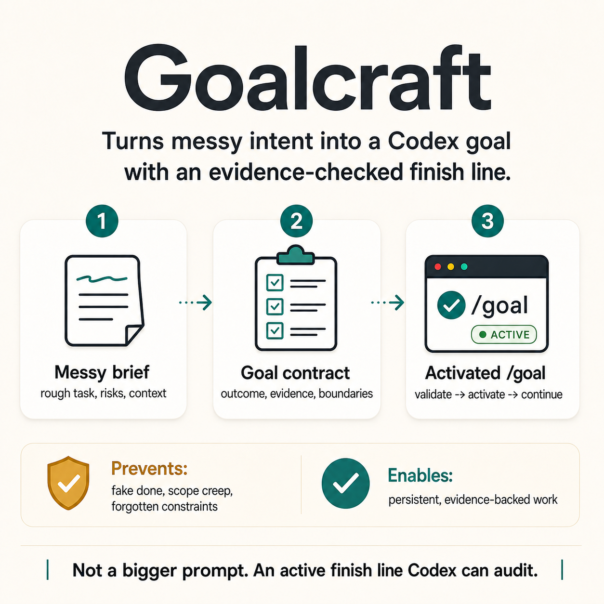

# Goalcraft

<!-- yarkr:badges:start -->
[](https://yarkr.com/arks/grp06/goalcraft)
<!-- yarkr:badges:end -->

Goalcraft turns a messy task description into a Codex `/goal` and activates it.

When you use `/goal`, Codex works against a persistent, thread-scoped completion contract. A weak goal means the agent may claim "done" on something that isn't. Goalcraft writes compact launcher goals that define the outcome, verification surface, constraints, boundaries, iteration policy, and blocked stop condition, so the agent has to show real evidence before declaring success. For long-running work, it also pushes the goal toward a tight loop: choose an action, run it, score it with a fast evaluator or checklist, record the result, and continue or stop based on evidence.

## Install

Clone the repo, then symlink it into your Codex skills directory:

```bash
git clone https://github.com/grp06/goalcraft.git
cd goalcraft
ln -s "$(pwd)" ~/.codex/skills/goalcraft
```

If your Codex setup uses a different skills directory, symlink the repo there instead. The skill is self-contained; it does not depend on any local project path.

Restart Codex, then invoke it with a rough brief. The brief doesn't need to be clean — that's the point:

> Use `$goalcraft` to turn this into a Codex `/goal`:
>
> I need to clean up the billing settings page in the web app. It's kind of half-done from a previous pass. The upgrade button works but the loading and error states are janky, and I think mobile is probably broken. Please make it match the rest of the settings UI, don't touch the Stripe webhook stuff or pricing logic unless something is obviously wrong, and don't do a huge refactor. It should have tests or at least whatever checks this repo normally uses. I want Codex to keep going until the page is actually usable and verified, but it should stop and ask me before changing public APIs, database schema, or anything payment-risky.

<!-- yarkr:install:start -->
## Install with Yarkr

This repo is indexed on [Yarkr](https://yarkr.com/arks/grp06/goalcraft) as the ark [grp06/goalcraft](https://yarkr.com/arks/grp06/goalcraft), so its skills install into Claude Code, Codex, Cursor and other agent harnesses with one command.

### CLI

Install the whole ark, which Yarkr keeps equal to this repo:

```bash
npx yarkr-cli sync grp06/goalcraft
```

Or add individual skills:

```bash
npx yarkr-cli add skill:grp06/goalcraft/goalcraft
```

No Node.js? `curl -fsSL https://yarkr.com/install.sh | sh` (macOS, Linux) or `irm https://yarkr.com/install.ps1 | iex` (Windows PowerShell) installs `yarkr` as a standalone binary; then type `yarkr` in place of `npx yarkr-cli`.

### MCP

Connect your agent to the ark over MCP:

```bash
npx yarkr-cli mcp add grp06/goalcraft
```

Or point any MCP client at `https://api.yarkr.com/functions/v1/api/mcp/o/grp06/goalcraft`.
<!-- yarkr:install:end -->

## What you get back

An activated `/goal` that spells out:

- **Outcome** — what must be true when the work is done
- **Verification surface** — tests, benchmarks, logs, reports, screenshots, source material, or explicit confirmation that proves it
- **Constraints** — what must not regress while Codex works
- **Boundaries** — files, systems, tools, data, repositories, and user-controlled actions to stay within
- **Iteration policy** — how Codex should choose the next useful action after each attempt
- **Blocked stop condition** — when to stop, what evidence to report, and what input would unlock progress
- **Durable state** — plan, experiment, decision, or notes files when the goal may run for hours or days

The `/goal` itself is intentionally short. Goalcraft puts supporting rationale, examples, candidate lists, and detailed evaluator notes outside the goal unless they are execution-critical.

By default, Goalcraft validates and activates the goal. Ask for a draft-only, review-only, or planning-only pass when you want text back without setting the active goal.

Goalcraft will also say when a normal prompt is the better tool. One-line edits, simple explanations, short code reviews, or vague requests without an auditable finish line usually need either a normal Codex prompt or a goal-sharpening pass before activation.

## Length safety

Codex caps `/goal` text at 4,000 characters. Goalcraft treats that as the hard limit and avoids repeatedly shortening drafts that already fit. If a normal draft exceeds the hard limit, Goalcraft switches to a compact fallback instead of shaving a few characters repeatedly. If you want to check a goal manually from this repo:

```bash
python3 scripts/validate_goal_length.py --max-chars 3999 goal.txt
```

That script is bundled with this Goalcraft repo. When the skill is used while working in another project, agents should resolve `scripts/validate_goal_length.py` relative to Goalcraft's own `SKILL.md`, not relative to the project being edited. If the skill runtime does not expose that path, Goalcraft's instructions include an inline Python fallback that works anywhere with Python 3.
